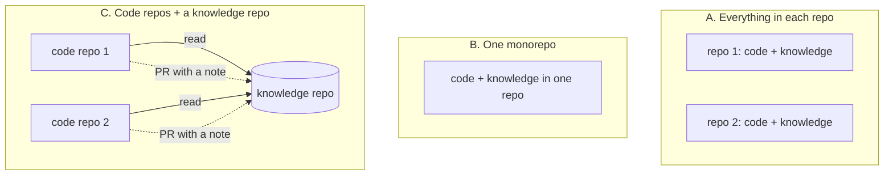

# Shared team memory

Alone, the error log and learnings live in your repository. In a team, each person's agent would relearn the same lessons. Shared memory means everyone's agent reads and writes to the same place.

## Three topologies

| | A. Per repo | B. Monorepo | C. Separate knowledge repo |
|---|---|---|---|
| Setup | None | None | One extra repo, shared read access |
| Sharing lessons across projects | No | Yes, inside the monorepo | Yes, across all repos |
| Risk | Duplicated, drifting notes | Big repo, noisy history | Needs a PR habit |
| Good for | Individual labs | One product team | Several projects, a team of agents |

## Rules for a shared knowledge repository

- Agents propose notes by pull request. They do not push to main.
- One file per entry (for errors: `errors/2026-11-27-<slug>.md`) so two people never edit the same file.
- Index files are generated from the entries, not edited by hand.
- Each entry has status `verified | from-docs | unverified` and `Last checked`.
- Keep it private if it names clients, systems or people. Never store secrets.
- A person reviews and merges. Run `/memory-review` regularly to retire stale notes.

## How a code repo points to it

In the code repo `AGENTS.md`, add: where the knowledge repository is (clone path next to the code repo), what to read first (`INDEX.md`), and how to propose a note (branch, one file, pull request). Agents can read it if it is cloned next to the code repository or added as a second folder in the VS Code workspace.

Whether Copilot or Genie Code can read a sibling folder depends on the workspace setup (`unverified`; test it in lab 06).
